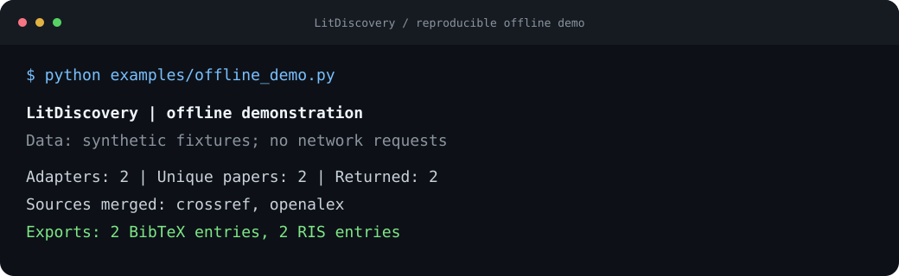
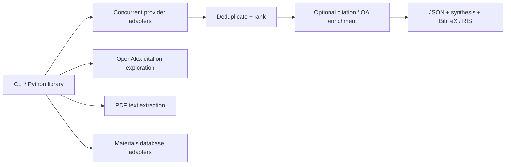

<div align="center">

# LitDiscovery

**Scientific literature discovery, built for the terminal.**

Search across research databases. Explore citation networks. Turn papers into inspectable records and reusable references.

[](https://github.com/rehan-hasnain/lit-discovery/actions/workflows/ci.yml)
[](https://github.com/rehan-hasnain/lit-discovery/actions/workflows/codex-skill.yml)
[](pyproject.toml)
[](LICENSE)

[Quick start](#quick-start) | [Offline demo](#try-it-without-api-keys) | [Architecture](docs/architecture.md) | [Contributing](CONTRIBUTING.md)

</div>

## Why this exists

A literature search rarely ends with a list of titles. Research involves checking multiple databases, following references, reading PDFs, and carrying reliable metadata into the next experiment or manuscript.

LitDiscovery brings those steps into a scriptable Python CLI. It grew from chemistry and materials research workflows, with an emphasis on explicit sources, portable outputs, and a clear boundary between extracted text and scientific evidence.

## What you can do

| Workflow | Capability |
| --- | --- |
| **Discover** | Concurrent search across 12 database adapters, deduplication, and transparent keyword ranking. |
| **Explore** | Related works, papers citing a seed, and references cited by a seed, using OpenAlex. |
| **Read** | PDF text and section extraction with candidate material-property mentions. |
| **Export** | BibTeX and RIS with DOI content negotiation and local metadata fallbacks. |
| **Connect** | Structural materials queries through Materials Project OPTIMADE, OQMD, C2DB, and MOFdb. |
| **Preserve** | Optional [Chem-Mat-Hub CLI](codex/chem-mat-hub/README.md) for bounded pagination, PDF/OCR evidence, diagnostics, and a persistent SQLite research library. |

No web application, hosted API, or OpenAI API key is required. Database queries still contact external providers and may require credentials or subscriptions.

## Quick start

Requires **Python 3.10+**. Tested in CI on Python 3.10, 3.12, and 3.14.

```bash
git clone https://github.com/rehan-hasnain/lit-discovery.git
cd lit-discovery
python -m venv .venv
```

Activate the environment:

```bash
# macOS / Linux
source .venv/bin/activate

# Windows PowerShell
.venv\Scripts\Activate.ps1
```

Install and run a focused search:

```bash
python -m pip install -e .
lit-discovery --help
lit-discovery search "polymer electrolyte conductivity" --engines crossref,openalex --top 5 --no-enrich
```

The default search uses all configured adapters. Narrowing engines makes a first run easier to inspect. Provider availability, rate limits, and coverage vary.

## Try it without API keys

Run the complete search-to-export path against **synthetic fixtures**, without network calls:

```bash
python examples/offline_demo.py
```



The demo exercises the real dispatcher, ranking, deduplication, synthesis, and citation exporter. Synthetic titles and authors are clearly identified; outputs use a temporary directory. See [examples](examples/README.md) for live workflows.

## CLI reference

| Command | Example |
| --- | --- |
| Search | `lit-discovery search "solid polymer electrolyte" --engines crossref --top 5` |
| Export citations | `lit-discovery search "aramid electrolyte" --bib references.bib --ris references.ris` |
| JSON for scripts | `lit-discovery search "ionogel" --no-enrich --json > results.json` |
| Citing papers | `lit-discovery graph "10.1038/nature12373" --mode forward --limit 5` |
| Cited references | `lit-discovery graph "10.1038/nature12373" --mode backward --limit 5` |
| Read a PDF | `lit-discovery read "10.1038/nature12373" --pages 20 --json` |
| Material structures | `lit-discovery materials --formula "MoS2" --json` |
| Porous frameworks | `lit-discovery materials --mof "UiO-66"` |

Use `<command> --help` for all options. JSON goes to stdout; progress goes to stderr. JSON and citation export flags can be combined.

### Provider configuration

Copy [`.env.example`](.env.example) to `.env` and fill only the variables you need. Empty values leave optional credentials unset. Process environment variables take precedence.

| Variable | Used for |
| --- | --- |
| `S2_API_KEY` | Optional Semantic Scholar authentication. |
| `CORE_API_KEY` | CORE access. |
| `SCOPUS_API_KEY` | Scopus access, subject to provider permissions. |
| `CHEM_MAT_HUB_UNPAYWALL_EMAIL` | Opt-in contact sent to Unpaywall when resolving open-access locations. |

Adapters: OpenAlex, Crossref, Semantic Scholar, Europe PMC, arXiv, Scopus, OSTI, DOAJ, DataCite, PubMed, CORE, and Zenodo. An adapter being present does not establish current provider availability. There is no bundled subscription or institutional-access guarantee.

### Extended chemistry and materials workflow

The optional [Chem-Mat-Hub CLI](codex/chem-mat-hub/README.md) is distributed separately from the Python package:

```bash
python -m pip install -r codex/chem-mat-hub/requirements.txt
python codex/chem-mat-hub/scripts/codex_hub.py --doctor
python codex/chem-mat-hub/scripts/codex_hub.py --literature "ionogel conductivity" --fetch-fulltext 0 --library-dir ./research-library
```

It adds identity-checked ILThermo tables, bounded pagination, retry/cache controls, per-source diagnostics, local PDF/OCR evidence, and a persistent library with an offline graph export. These features belong to the extended CLI; the base package does not automatically inherit them.

## How it is built



The [architecture notes](docs/architecture.md) describe module boundaries, concurrency, failure behavior, testing, and tradeoffs. The [roadmap](docs/roadmap.md) separates current behavior from planned improvements.

## Development

```bash
python -m pip install -e ".[dev]"
python -m pytest tests -q
```

Optional research workflow tests:

```bash
python -m pip install -r codex/chem-mat-hub/requirements.txt
python -m pytest --rootdir codex/chem-mat-hub --confcutdir codex/chem-mat-hub/tests codex/chem-mat-hub/tests -q
```

Unit tests use controlled responses, temporary files, and generated PDFs. They do not require live database access. CI also builds and checks the package distribution.

## Research boundaries

- Keyword scores are retrieval heuristics, not calibrated probabilities or scientific confidence.
- Citation classifications are provider metadata, not proof of replication or scientific consensus.
- Base PDF/property extraction finds candidate mentions. It does not reliably resolve specimen, test conditions, units, or causality; validate against the original paper.
- The base reader handles text PDFs and uses an explicit page limit. OCR, page evidence, and persistent storage are extended-CLI features.
- Search results are bounded by selected providers and retrieval limits. The base CLI can conflate a provider's empty response with unavailable results; use extended diagnostics when coverage matters.
- Keep credentials, subscription PDFs, research records, and unpublished analysis out of Git. See [security guidance](SECURITY.md).

## License and citation

Project source is available under the [Apache License 2.0](LICENSE); see [NOTICE](NOTICE) for attribution. Bundled OCR model attribution is included in NOTICE, with [pinned model provenance](codex/chem-mat-hub/assets/tessdata/source.json); third-party dependencies retain their own licenses. If this tool supports your work, use [CITATION.cff](CITATION.cff).
